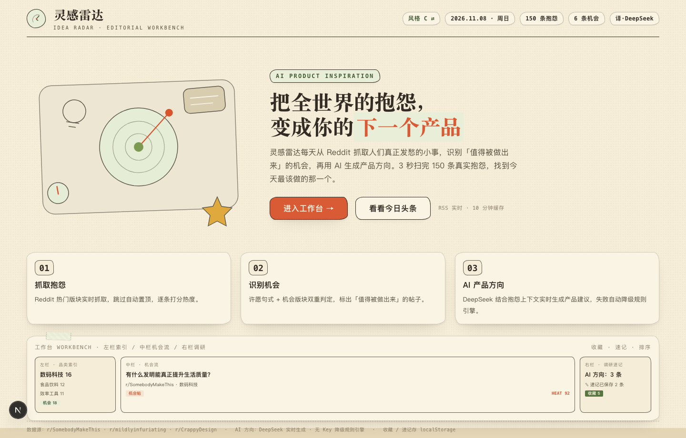
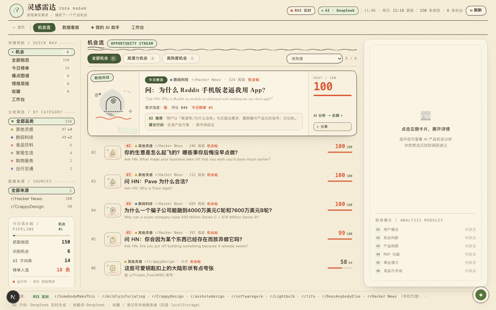
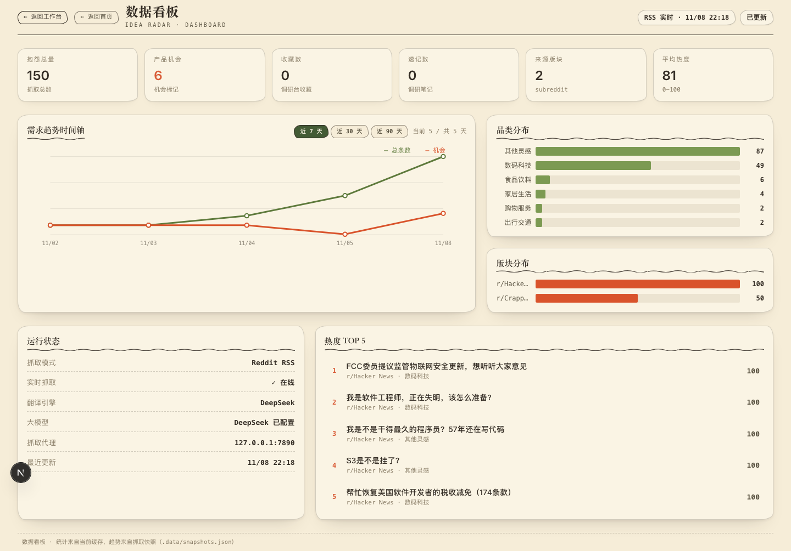

# 灵感雷达 IDEA RADAR

> 把全世界的抱怨，变成你的下一个产品。

**灵感雷达（IDEA RADAR）** 是一个 AI 产品机会发现平台：从 Reddit 等社区的抱怨中识别真实需求，用 AI 分析成可落地的产品机会。它回答了产品人最常问的问题——*「下一个产品做什么？」*

本项目为**独立开发的作品项目**，完整实现了从数据抓取 → 需求识别 → AI 分析 → 产品方案的完整闭环，包含 DeepSeek 大模型与本地规则引擎的双模式 AI 架构。







---

## ✨ 核心亮点

- **真实数据驱动**：Reddit 8 版块 + Hacker News（Ask HN）真实抓取，不虚构需求
- **需求识别引擎**：从抱怨中自动识别「机会帖」（许愿句式 / 机会版块双重判定）
- **双模式 AI 架构**：配置 `DEEPSEEK_API_KEY` 走大模型，无 Key 自动降级本地规则引擎，演示环境永远可用；引擎类型在界面外显标注
- **完整产品方案生成**：AI 一键生成六节产品方案（定位/画像/功能/MVP/商业模式/验证），可复制可存入调研速记
- **产品人工作台**：收藏、调研速记、状态管理、横向对比、Markdown 导出
- **数据看板**：真实抓取快照趋势图、品类/版块分布、系统运行状态

## 🗂 功能清单

| 模块 | 说明 |
|---|---|
| 机会情报流 | 精选机会卡 + 机会列表，支持分类/来源/机会类型/热度/评分筛选与排序 |
| AI 产品机会分析中心 | 六模块：用户痛点 / 机会判断 / 产品构想 / MVP 功能 / 商业潜力 / 竞品与市场 |
| 完整产品方案生成 | 基于单条机会或产品构想方向，AI 生成结构化产品方案 |
| 收藏 + 调研工作台 | 收藏状态（想做的/在调研/已放弃）、调研速记自动保存、多视图切换 |
| 痛点关联图谱 / 情报简报 | P2 智能情报功能，聚合品类级洞察 |
| 分享卡片 | 手绘风海报，一键下载 PNG / 复制文案 |
| AI 助手 | 右下角悬浮对话，快捷提问 + 自动建议，引擎类型外显 |
| 数据看板 | 统计卡片、需求趋势（7/30/90 天）、品类/版块分布、运行状态 |
| 首页双风格 | 复古编辑部（/）+ 治愈系柔和（/home-c）双落地页并存 |

## 🧠 双模式 AI 架构

| 能力 | 有 DeepSeek Key | 无 Key |
|---|---|---|
| 标题翻译 | LLM 批量翻译 | 免费机译（Google） |
| 产品构想 / AI 推荐 | DeepSeek 生成 | 规则引擎推导（按品类聚类取 Top 痛点） |
| 完整产品方案 | LLM 撰写六节方案 | 规则模板生成结构化骨架 |
| AI 助手对话 | 真实大模型 | 本地知识库规则回答 |

所有分析与评分均基于**真实抓取字段 + 规则/LLM 推导**，无虚构市场数据；无数据支撑处明确标注「待验证」。

## 🛠 技术栈

- **Next.js 15 + TypeScript + Tailwind CSS v3**
- **数据源**：Reddit RSS（经本机代理抓取）+ Hacker News Algolia API（Ask HN）
- **LLM**：DeepSeek 官方 API（`chatCompletion` / `chatJSON`）
- **无第三方 UI 库**：全部组件手写，复古编辑部视觉规范

## 🚀 快速开始

```bash
# 1. 安装依赖（需 Node.js >= 18）
npm install

# 2. 配置（可选）：填入 DeepSeek Key 启用大模型能力
cp .env.example .env
#   在 .env 中设置 DEEPSEEK_API_KEY=sk-xxx 与 REDDIT_PROXY=http://127.0.0.1:7890

# 3. 启动
npm run dev        # 开发模式 http://localhost:3001
# 或
npm run build && npm start
```

> 国内网络抓取 Reddit 需本地代理（默认 `127.0.0.1:7890`，可在 `.env` 的 `REDDIT_PROXY` 调整）。无代理时自动降级为磁盘缓存 / 内置种子数据，站点始终可用。

## 📁 目录结构（关键文件）

```
src/
├── app/
│   ├── page.tsx              # 落地页（复古编辑部风）
│   ├── home-c/page.tsx       # 落地页（治愈系柔和）
│   ├── workbench/page.tsx    # 三栏工作台主页面
│   ├── dashboard/page.tsx    # 数据看板
│   └── api/                  # complaints / notes / assistant / insights / dashboard 接口
├── components/
│   ├── Header.tsx            # 顶部双层导航（品牌 + 系统状态）
│   ├── Rail.tsx              # 左栏筛选中心（快捷导航/分类/来源/今日流水线）
│   ├── Stream.tsx            # 中栏机会流（精选卡/筛选工具栏/机会列表）
│   ├── DetailPanel.tsx       # 右栏 AI 分析中心（六模块 + 完整产品方案）
│   ├── BriefPanel.tsx        # 情报简报
│   ├── ClusterPanel.tsx      # 痛点关联图谱
│   ├── ShareCard.tsx         # 分享卡片
│   └── AssistantPanel.tsx    # AI 助手悬浮面板
├── lib/
│   ├── reddit.ts             # 数据抓取：Reddit RSS + Hacker News，代理/限流/缓存降级
│   ├── translate.ts          # 标题翻译（LLM / 免费机译双通道）
│   ├── llm/client.ts         # DeepSeek 客户端
│   ├── rank.ts               # 每日榜单
│   ├── dashboard.ts          # 看板统计 + 快照趋势
│   └── rules/                # 规则引擎：分类/机会判定/洞察/助手/周报/聚类
scripts/daily-refresh.sh      # 每日自动刷新（launchd 定时触发）
proxy.py                      # 本地代理脚本（可选）
```

## 📊 数据来源说明

- Reddit 8 版块串行/并发限流保护抓取，磁盘缓存到 `.data/cache.json` 保证离线可演示
- Hacker News 通过 Algolia API 抓取 Ask HN 高分帖（与 Reddit 并行，失败不影响主链路）
- 无历史趋势数据时不生成虚假图表，相关功能在数据不足时置灰

## 📬 联系

- GitHub: [stream121/idea-radar](https://github.com/stream121/idea-radar)
- 作者：时梨序（黄丹婷）· 27 届应届毕业生 · 求职产品助理/产品运营
